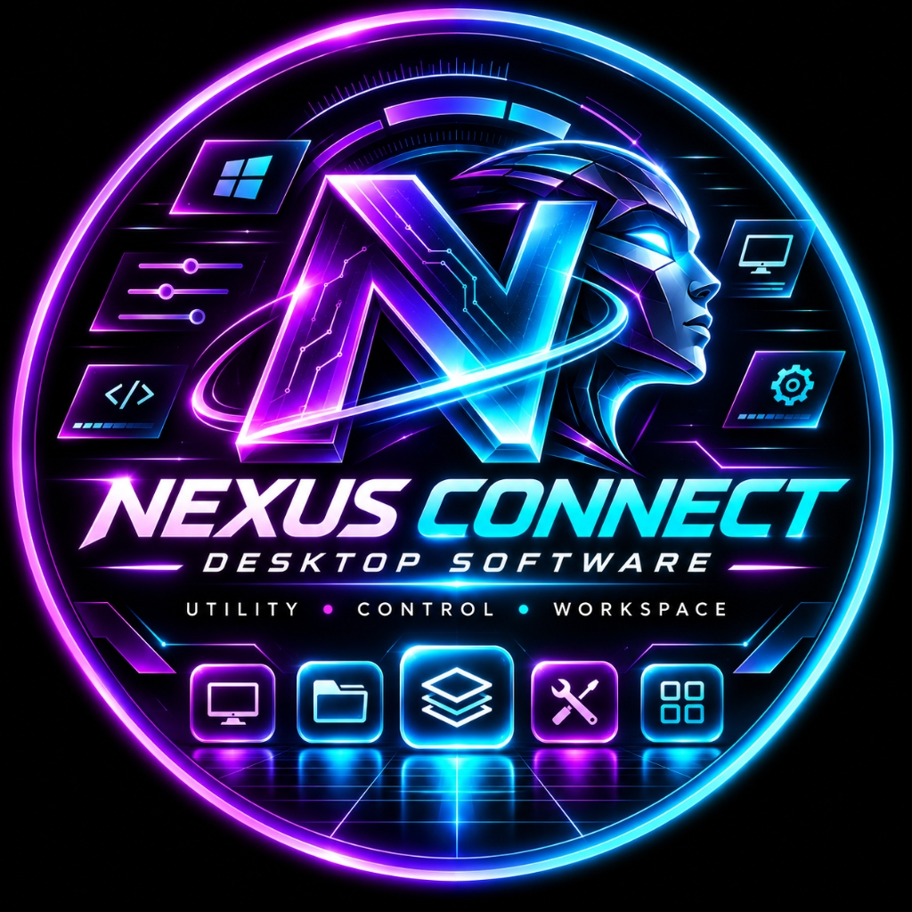

<p align="center">
  <a href="https://t.me/nexus_connect_beta">
    
  </a>
</p>

# ⚡ NEXUS IDE Ultimate
### Модифицированная сборка Antigravity с поддержкой российских аккаунтов

<p align="left">
  <a href="https://t.me/nexus_connect_beta"></a>
  <a href="https://t.me/nexus_connect_support_bot"></a>
  
  
  
</p>

---

### 💡 Что это такое?

**NEXUS IDE Ultimate** — это специальная модифицированная редакция **Google Antigravity (линейки 2.32+)**, полностью адаптированная для стабильной работы разработчиков из России.

По своей сути это **тот самый мощный Antigravity со всеми возможностями AI-кодинга и доступом к моделям Gemini**, но избавленный от главных региональных проблем:
* **Работает с российскими Google-аккаунтами:** не нужно регистрировать зарубежные почты или искать обходные пути — вы просто входите под своим личным Gmail-аккаунтом.
* **Без бесконечного спиннера авторизации:** исправлена проблема зависания окна входа, с которой сталкивается большинство пользователей в РФ.
* **Без навязчивых анкет Google на старте:** программа открывается сразу в главное рабочее меню, пропуская блокирующие проверки и опросы.
* **Полная русификация из коробки:** интерфейс уже переведён на русский язык с удобным переключателем `RU / EN` в один клик.

---

### 🚀 Статус проекта: Открытое бета-тестирование

Мы делаем рабочий инструмент для разработчиков и открыто делимся им с сообществом, чтобы вместе обкатать и довести сборку до идеала:
* **Windows (x64):** установщик `NEXUS_IDE_Ultimate_Setup.exe` готов и доступен в боте.
* **Linux (x64):** архив `NEXUS_IDE_Linux_x64.tar.gz` готов и доступен в боте (Ubuntu, Debian, Mint, Fedora, Arch).

> 💡 **Как попробовать прямо сейчас:**  
> 1. Откройте бота [**@nexus_connect_support_bot**](https://t.me/nexus_connect_support_bot) и скачайте сборку командой `/ide` (Windows) или `/ide linux` (Linux).  
> 2. Возьмите бесплатный персональный ключ на 1 месяц командой `/key` (нужен для защиты сборки от спама и учёта участников теста; по истечении месяца можно обновить через автора в чате).  
> 3. Заходите в наш чат [**t.me/nexus_connect_beta**](https://t.me/nexus_connect_beta) — там мы собираем обратную связь и помогаем с запуском.

---

### 💎 Что добавлено и улучшено в этой версии

1. **Честная авторизация под РФ-аккаунтами**  
   Корректное прохождение входа без сброса токенов и ошибок региональных ограничений.

2. **Эргономика и русскоязычный интерфейс**  
   * **Переключатель языка в 1 клик:** мгновенная смена `RU / EN` прямо на экране без перезапуска редактора.  
   * **Библиотека быстрых шаблонов:** удобная чистая вкладка для сохранения собственных промптов и частых инструкций.  
   * **Контроль сессии и контекста:** живой счётчик расхода токенов и таймер сессии прямо над строкой ввода — вы всегда видите объём контекста в диалоге.

3. **Приватность и локальность**  
   Все ваши проекты, код и файлы остаются строго на вашем компьютере. При необходимости технической помощи формируется изолированный зашифрованный диагностический отчёт без передачи исходного кода.

---

### 📖 Быстрый старт (для участников закрытого теста)

#### Windows
1. Получите установщик `NEXUS_IDE_Ultimate_Setup.exe` в нашем Telegram-чате [**t.me/nexus_connect_beta**](https://t.me/nexus_connect_beta) или отправьте команду `/ide` боту [@nexus_connect_support_bot](https://t.me/nexus_connect_support_bot).
2. Запустите инсталлятор и дождитесь завершения установки (меньше минуты).
3. Запустите ярлык **NEXUS IDE Ultimate** с Рабочего стола — программа сразу откроет главное меню.
4. Откройте панель настроек в верхнем углу, введите выданный ключ доступа и нажмите **«Включить»**.
5. Нажмите **«Войти в аккаунт»** (или перейдите в `Settings → Account → Sign In`) и авторизуйтесь под своим аккаунтом.
6. Открывайте проект и работайте в привычном интерфейсе Antigravity.

#### Linux (x64)
1. Получите архив `NEXUS_IDE_Linux_x64.tar.gz` через команду `/ide linux` в боте [@nexus_connect_support_bot](https://t.me/nexus_connect_support_bot).
2. Откройте терминал (`Ctrl + Alt + T`) и перейдите в папку загрузок:
   ```bash
   cd ~/Загрузки || cd ~/Downloads
   ```
3. Распакуйте архив **строго через терминал** (чтобы сохранились права на запуск) и перейдите в папку:
   ```bash
   tar -xzf NEXUS_IDE_Linux_x64.tar.gz
   cd Antigravity-x64
   ```
4. Установите системные библиотеки для движка (делается 1 раз):
   * **Ubuntu / Debian / Mint:** `sudo apt update && sudo apt install -y libnss3 libasound2t64 || sudo apt install -y libnss3 libasound2`
   * **Fedora / RHEL:** `sudo dnf install -y nss alsa-lib`
   * **Arch / Manjaro:** `sudo pacman -S --needed nss alsa-lib`
5. Запустите IDE:
   ```bash
   ./run-nexus-ide.sh
   ```
   *(Если возникнет `Permission denied`: `chmod +x antigravity chrome-sandbox chrome_crashpad_handler run-nexus-ide.sh resources/bin/language_server resources/bin/.msrt/language_server_linux_rt.dat *.so* && ./run-nexus-ide.sh`)*
6. Получите персональный тестовый ключ на 1 месяц командой `/key` в боте [@nexus_connect_support_bot](https://t.me/nexus_connect_support_bot) и активируйте при первом запуске.
7. Войдите в Google-аккаунт (`login here` на верхней плашке или `Settings → Account → Sign In`). Если уже включён системный VPN в режиме TUN, прокси внутри IDE включать не нужно.

---

### 💬 Сообщество и Обратная связь

* 🧪 **Тестовый доступ и баг-репорты:** программы сейчас находятся в тестовом доступе. Если вы столкнулись с ошибкой или что-то работает не так — напишите саппорт-боту [@nexus_connect_support_bot](https://t.me/nexus_connect_support_bot) в ЛС (командой `/bug описание` или просто приложите скриншот / лог). Бот запишет проблему в базу и сразу передаст отчёт разработчику.
* 👥 **Telegram-чат проекта:** [t.me/nexus_connect_beta](https://t.me/nexus_connect_beta)
* 🌐 **Если у вас нет стабильного VPN:** рабочий VPN можно подключить через [@nexus_ai_ru_bot](https://t.me/nexus_ai_ru_bot)
